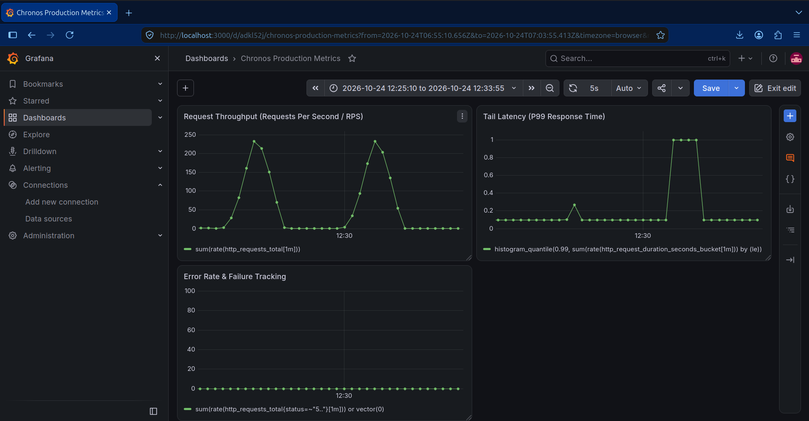

# Chronos Ledger Engine

A high-concurrency, fault-tolerant financial ledger and transaction engine built for strict ACID compliance, zero double-spending, resilient caching, and real-time observability.

## Architectural Overview

Chronos is engineered to handle heavy concurrent transaction workloads without sacrificing data integrity or performance. By avoiding heavy ORMs in favor of direct database optimizations, connection pooling, and resilient caching patterns, Chronos maintains consistent low-latency throughput under pressure.

### System Topology & Data Flow

```text
 [Client / k6 Load Tester]
            │
            ▼
     [ Nginx Load Balancer ]
            │
            ├─────────────────────────┬─────────────────────────┐
            ▼                         ▼                         ▼
     [ FastAPI App 1 ]         [ FastAPI App 2 ]         [ FastAPI App 3 ]
            │                         │                         │
            ├─────────────────────────┴─────────────────────────┤
            ▼                                                   ▼
     [ Redis (Idempotency Cache) ]                       [ PgBouncer Pooler ]
     *(Fail-Open Graceful Degradation)*                         │
                                                                ▼
                                                        [ PostgreSQL 15 ]
                                                                │
                                         ┌──────────────────────┴────────────────────┐
                                         ▼                                           ▼
                                  [ Apache Kafka ]                            [ RabbitMQ ]
                              (Event Streaming / Log)                    (Async Background Tasks)

```

---

## Project Structure

```text
chronos/
├── app/                  # FastAPI core application (api routes, schemas, core config)
├── config/               # Infrastructure configurations (nginx.conf, prometheus.yml)
├── k6_scripts/           # Dual-profile k6 load testing suites (Distributed & Contention)
├── Dockerfile            # Container definition for FastAPI app replicas
├── docker-compose.yml    # Full-stack multi-container orchestration
├── requirements.txt      # Pinned, conflict-free dependency definitions
├── schema.sql            # PostgreSQL database schema and initial tables
├── worker.py             # Asynchronous RabbitMQ/Kafka background consumer worker
└── README.md

```

---

## Performance & Proof-of-Work (Dual-Profile Load Testing)

Chronos is rigorously validated using **k6** across two distinct performance profiles, backed by real-time metric collection via **Prometheus** and dashboard visualization via **Grafana**.

### 1. Distributed Scale Profile (`k6_scripts/load_test_distributed.js`)

Simulates a high-volume retail banking environment by partitioning writes across a pool of 50 independent accounts to benchmark raw throughput and connection pooling.

- **Throughput:** Sustained ~201 RPS across 14,100+ transactions over 70 seconds.
- **Tail Latency:** Achieved a median latency of **7.31ms**, with a **p(95) of 16.13ms** and **p(99) of 25.54ms**.
- **Failure Rate:** **0.00% failure rate** (14,132/14,132 requests succeeded) with 100% check verification.

### 2. Hot-Row Contention Profile (`k6_scripts/load_test_contention.js`)

Tests extreme concurrency limits against a single entity row (`usr_k6_stress_v2`) using row-level locks (`SELECT FOR UPDATE`).

- **Throughput:** Sustained ~199 RPS across 13,900+ transactions targeting the identical account row.
- **Controlled Queueing:** Median response time stayed low at **6.44ms**, while row serialization deliberately shifted tail latencies (**p(95) of 881.65ms**, **p(99) of 1.57s**) as requests queued safely for the lock.
- **Data Safety:** **0.00% failure rate** with 100% check pass rate (27,883/27,883 checks), proving zero race conditions, deadlocks, or double-spending under peak row contention.
---

### Real-Time Observability (Grafana Dashboard)

Real-time metric collection via Prometheus visualized through Grafana during peak load testing:



---

## Resilience & Chaos Engineering

Financial systems must survive infrastructure failures gracefully. Chronos implements robust fault-tolerance mechanisms:

1. **Multi-Tiered Fail-Open Idempotency (Defense-in-Depth):**
   - **Tier 1 (Redis Fast-Path Shield):** Traps >99% of duplicate requests and retries in sub-millisecond in-memory cache, short-circuiting before reaching the database.
   - **Fail-Open Wrapper:** If Redis experiences an outage, high latency, or eviction pressure, Chronos gracefully degrades and routes execution directly to PostgreSQL, preventing cache failures from causing cascading HTTP 500 API outages.
   - **Tier 2 (PostgreSQL Ground Truth Fallback):** Even with Redis offline, financial invariants remain strictly protected. PostgreSQL enforces idempotency via a `UNIQUE INDEX (idempotency_key)` on `ledger_entries` combined with atomic pre-execution lookups, ensuring zero duplicate balance mutations even during complete cache blackouts.
2. **Seamless Load Balancer Failover:** Nginx load balances traffic across multiple FastAPI container replicas (`app-1`, `app-2`, `app-3`), ensuring zero downtime during individual container scaling or restarts.

---

## Core Engineering Decisions

1. **Bypassing ORMs for Raw AsyncPG:**
* Heavy ORMs introduce hidden query overhead and abstraction leaks when managing fine-grained transaction boundaries. Using **AsyncPG with raw SQL** gives direct control over transaction scopes, query execution plans, and explicit row locking.


2. **Dual-Tier Idempotency with Fail-Open Safety:**
   - Financial APIs require strict idempotency to prevent duplicate charges or transfers from client retries. 
   - Chronos avoids the single-point-of-failure trap of pure cache-based idempotency. It pairs **Redis distributed locking/caching** (for raw latency and connection shielding) with **PostgreSQL database-level constraints** (`UNIQUE` index and row validation). If the cache tier drops, the system sacrifices caching speed for 100% availability without sacrificing ledger consistency.


3. **Transaction Pooling via PgBouncer:**
* Direct high-concurrency connections can overwhelm PostgreSQL's connection limit. PgBouncer multiplexes client connections efficiently, preventing connection storms and keeping database memory footprints stable.


---

## Quickstart & Local Setup

Get the entire containerized stack up and running in under 2 minutes.

### Prerequisites

* [Docker & Docker Compose](https://docs.docker.com/get-docker/) installed on your machine.
* [k6](https://k6.io/) installed locally (if running load tests outside Docker).

### 1. Clone the Repository

```bash
git clone [https://github.com/your-username/chronos-ledger-engine.git](https://github.com/your-username/chronos-ledger-engine.git)
cd chronos-ledger-engine

```

### 2. Spin Up the Stack

Build and start all services (FastAPI replicas, Nginx, PostgreSQL, PgBouncer, Redis, Kafka, RabbitMQ, Prometheus, and Grafana):

```bash
docker compose up --build -d

```

### 3. Initialize Database Schema

Run the `schema.sql` script to create the required tables (`accounts`, `ledger_entries`) and performance indexes inside your PostgreSQL container:

```bash
docker exec -i chronos-postgres psql -U postgres -d chronos_db < schema.sql

```

*(Note: Replace `chronos-postgres`, `postgres`, and `chronos_db` with your actual container name, username, and database name from your environment configuration if they differ).*

### 4. Verify Health & Observability

* **API Gateway (Nginx):** `http://localhost/ledger/transaction`
* **Prometheus UI:** `http://localhost:9090`
* **Grafana Dashboards:** `http://localhost:3000` *(Default login: `admin` / `admin`)*

### 5. Run k6 Load Tests

**Run the Distributed Throughput Benchmark:**

```bash
docker run --rm -i --net=host grafana/k6 run - < k6_scripts/load_test_distributed.js

```

**Run the Hot-Row Contention Profile:**

```bash
docker run --rm -i --net=host grafana/k6 run - < k6_scripts/load_test_contention.js

```